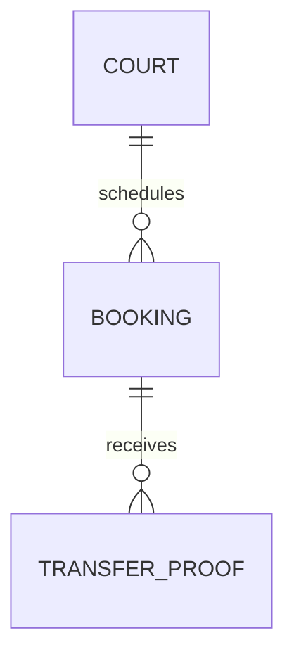

# Data model

## Storage decision

The futsal fixture chose Supabase under D-019. S2 records a shared online site and a small maintenance budget. S3 separates public booking from admin access and stores player contact data. S4 needs consistent slot updates across several phones. SQLite was considered for a single local venue device; the shared online booking requirements make it a weak primary store. Reassess when the owner changes who can book or which sites need offline use.

## Entities

| Entity | Key | Fields and constraints |
|---|---|---|
| Court | id UUID primary key | venue_owner UUID required, name text required, hourly_price_idr integer greater than zero |
| Booking | id UUID primary key | court_id UUID required foreign key, player_name text required, player_phone text required, slot_start timestamptz required, dp_status text with approved values |
| TransferProof | id UUID primary key | booking_id UUID required foreign key, object_ref text unique, uploaded_at timestamptz required |

## Relations

Court has zero or more bookings. Every booking has one court. Block deletion of a court with bookings. A booking has zero or more proof uploads until one is accepted. When booked information is deleted under the retention rule, remove its proof metadata and schedule deletion of the private object.

## Indexes

| Query | Index or constraint | Reason |
|---|---|---|
| Find one court's bookings by time | unique bookings (court_id, slot_start) | The same access path finds the range and enforces one booking per slot. |
| Find pending transfers in time order | bookings (dp_status, slot_start) | The admin filters status and sorts by time. |
| Find proof uploads by booking | transfer_proofs (booking_id, uploaded_at) | The foreign key supports the history and retention queries. |

## Migrations

Up: create the three tables, foreign keys, allowed states, indexes and policies in that order. Seed one court and verify it cannot take two bookings with the same start time.

Down: restore the pre-change backup if a live deployment has accumulated bookings. Before any production downgrade, export and verify the new data. In a disposable check database drop proofs, bookings and courts in reverse order.

## Verification

Test a duplicate slot and a missing foreign key. Confirm the admin can read their pending payments. Confirm a second venue sees no player contacts or proof objects. See SECURITY.md for the access checks.
