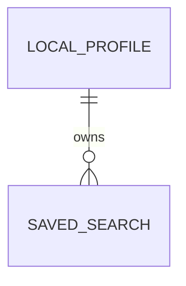

# Data model

## Storage decision

The synthetic KPR plan is for one owner on one device. The S2 plan uses a local Codex skill. The S3 plan keeps income, existing debt and exact location private. The owner needs saved searches in time order. Use local SQLite for atomic search history and an index, with a user-controlled JSON export. A single JSON file is the alternative for a profile without saved searches. Revisit if the owner requests synchronization and can define its data boundaries.

## Entities

| Entity | Key | Fields and constraints |
|---|---|---|
| LocalProfile | id integer primary key | monthly_income_idr positive integer, existing_debt_idr nonnegative integer, deposit_budget_idr nonnegative integer |
| SavedSearch | id integer primary key | profile_id integer foreign key required, recorded_at integer required, commute_limit_minutes positive integer, debt_share number between 0 and 1 |

## Relations

Each saved search belongs to one local profile. A profile may have no saved searches. Remove saved searches when their profile is explicitly deleted.

## Indexes

| Query | Index or constraint | Reason |
|---|---|---|
| Show recent saved searches for the current local profile | saved_search (profile_id, recorded_at DESC) | Filters by owner and orders the result. |
| Read or delete a selected search | saved_search primary key | Direct lookup by id. |
| Read the local income and debt values | local_profile primary key | One requested profile record. |

## Migrations

Up: enable foreign keys, create the two tables with checks, then create the search history index. Run on a copy of the local store first.

Down: export private data locally and inspect the export before rolling back. Restore the previous copy if saves have been added. In a disposable fixture drop saved_search before local_profile.

## Verification

Insert a profile and two valid searches. Verify recent searches use the sort index. Reject a missing profile, negative income and an invalid percentage. Export locally, then run the deletion test and confirm the stored searches disappear with the profile.
