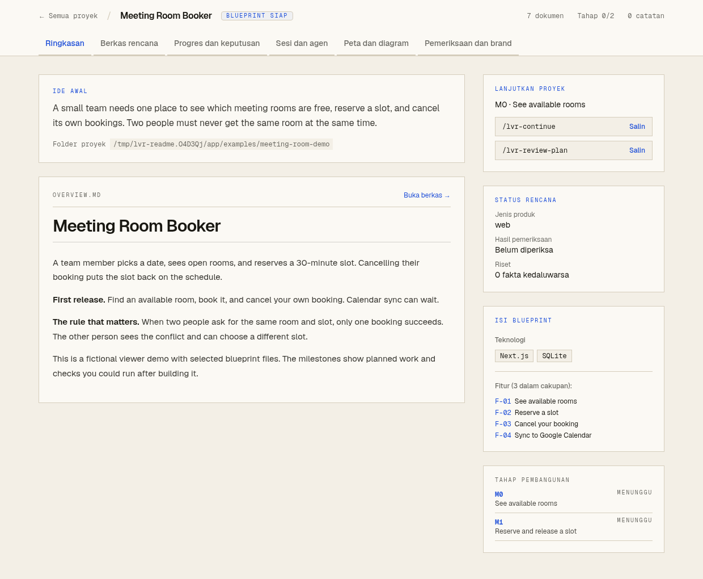

<div align="center">

# Lazy Vibers Recipe

**Turn a rough idea into a build plan another agent can pick up.**

[](skills/README.md)
[](#try-the-dashboard)
[](LICENSE)

[Try the dashboard](#try-the-dashboard) · [Start a new idea](#start-a-new-idea) · [Browse the sample plan](examples/meeting-room-demo/OVERVIEW.md)

</div>

---

Recipe's **agent skills** interview you about what you want to build, research open questions, and turn your decisions into a set of project files called a **Blueprint Bundle**. The **local dashboard** lets you read that plan, inspect diagrams, and see where a session left off.

[](docs/assets/readme/meeting-room-dashboard.png)

*Meeting Room Booker is a fictional plan. Its first release covers availability, reservations, and cancellations. Calendar sync stays parked.*

## Try the dashboard

You need **Node.js 24+**. The viewer runs on your machine and opens sample plans without an AI account or API key.

1. Clone the repo and start the viewer.

   ```bash
   git clone https://github.com/sayyidmibrahiim/lazy-vibers-recipe.git
   cd lazy-vibers-recipe
   npm ci
   npm run dev -- --hostname 127.0.0.1
   ```

2. Open [localhost:3000](http://localhost:3000). In **Buka Folder LVR Lokal**, enter `examples/meeting-room-demo` and click **Buka**. For your own plan, enter the project folder that contains `.lvr/state.json`.
3. Open **Berkas rencana** to read the plan files, or **Peta dan diagram** → **Relasi data** to see how rooms, members, and reservations connect.

<details>
<summary><b>See the data model in the dashboard</b></summary>


The sample includes [requirements](examples/meeting-room-demo/SPEC/requirements.md), a [data model](examples/meeting-room-demo/SPEC/data-model.md), and [checks for each milestone](examples/meeting-room-demo/VERIFICATION.md).

</details>

## Start a new idea

You need **Node.js 22.20+** and a coding agent that can search the web and read pages. This example installs all seven skills for **Codex** in a new project folder. See the commands for other agents in [the install guide](INSTALL.md).

1. In a terminal, make a project folder and install the skills.

   ```bash
   mkdir meeting-room-project
   cd meeting-room-project
   npx --yes skills@1.9.0 add sayyidmibrahiim/lazy-vibers-recipe --copy --skill '*' --agent codex --yes
   ```

2. Open Codex in that folder and paste this into the conversation.

   ```text
   $lvr-init-new-idea

   I want a web app for an eight-person team sharing two meeting rooms.
   People should see open 30-minute slots, reserve a slot, and cancel
   their own bookings. If two people request the same slot at once,
   only one should succeed. Leave calendar sync out of the first release.
   ```

3. When Recipe asks where to save the plan, choose to continue in the current folder. Answer the follow-up questions and confirm the scope. If you stop partway through, call `$lvr-continue` in the same folder to pick up from your recorded answers.
4. When the plan is ready, run `$lvr-review-plan`, resolve any findings that block the build, then run `$lvr-handoff`. Give a fresh builder session the generated `HANDOFF-PROMPT.md` and a first task like this.

   ```text
   Read HANDOFF-PROMPT.md and AGENTS.md. Build milestone M0 only.
   Run its checks in VERIFICATION.md and report what passed or failed.
   ```

Slash-command entry points include `/lvr-init-new-idea` and `/lvr-continue`. The Claude Code plugin uses `/lazy-vibers-recipe:lvr-init-new-idea`. [Skill catalog and install options](skills/README.md)

## What you get

```text
Idea → Interview → Blueprint → Review → Handoff → Build and verify
```

| Open this | To find out |
| --- | --- |
| `OVERVIEW.md` and `SCOPE.md` | What's included in the first release and what's parked |
| `SPEC/requirements.md` and `SPEC/data-model.md` | What each feature must do and what data it needs |
| `DECISIONS.md` and `ASSUMPTIONS.md` | What you confirmed and what still needs checking |
| `MILESTONES.md` and `VERIFICATION.md` | What to build first and how to prove it works |
| `HANDOFF-PROMPT.md` | Where a fresh builder session should start after handoff |

A full plan has **20 base Markdown files**, a `blueprint.json` index, and extra files for the types of product you choose. The local `.lvr/` folder keeps the answers, progress, and journal so a new session can resume from disk. [Bundle format](docs/spec/04-bundle.md)

## Ideas you can try

| If you're building | Give the agent a starting prompt like this |
| --- | --- |
| **Command-line tool** | “Build a CLI that finds duplicate images by SHA-256 and exports a CSV of matching paths. It should only read files.” |
| **n8n workflow** | “Every Monday, read a team spreadsheet and send one summary to Slack. Skip empty rows and tell me if the sheet is unreachable.” |
| **Browser extension** | “Save the current tab's title, URL, and my note into a local reading list. Let me export it as JSON.” |

Recipe also has profiles for mobile apps, MCP servers, skills and plugins, agents, document Q&A, and games. Once you have a plan, use `/lvr-add-feature` to revisit scope, `/lvr-build` to execute milestones with checks, or `/lvr-personal-brand` after release verification. [All seven skills](skills/README.md#choose-a-skill)

<details>
<summary><b>Production build and legacy generator</b></summary>

```bash
npm run build
npm start -- --hostname 127.0.0.1
```

The dashboard is a single-user local app without login and stores its project list in SQLite. The optional `/legacy` generator is off by default. To run it, copy `.env.example` to `.env.local`, set `ENABLE_LEGACY_GENERATOR=1`, configure your OpenAI-compatible `LLM_BASE_URL` and `LLM_MODEL`, and restart. Set `LLM_API_KEY` if your endpoint requires it.

</details>

---

[Installation by agent](INSTALL.md) · [Architecture and specs](docs/spec/00-overview.md) · [Contributor guide](AGENTS.md) · [Booster credits](CREDITS.md) · [MIT license](LICENSE)
