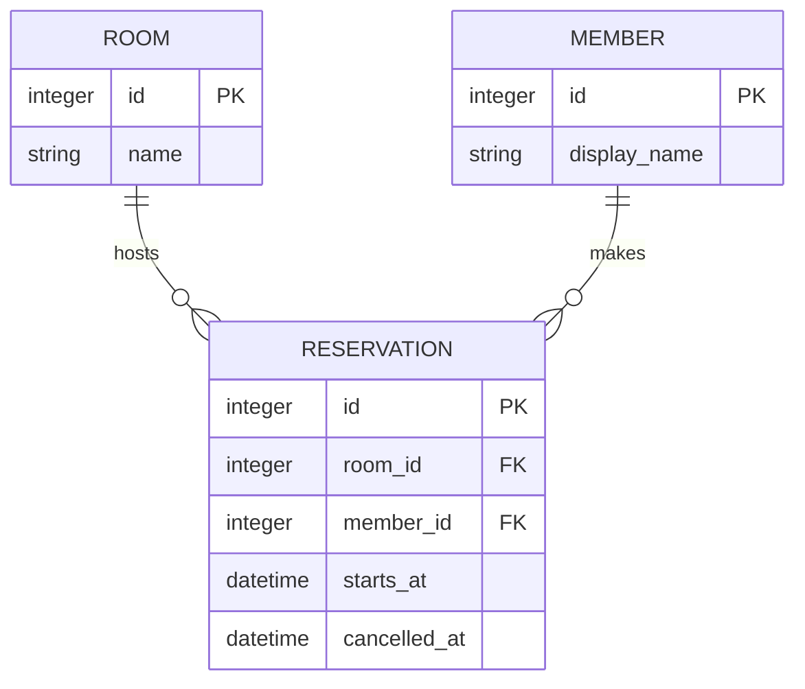

# Data model

Each reservation points to one room and one team member. Store the slot start in UTC and show it in the viewer's time zone. `(room_id, starts_at)` must be unique among active reservations.

