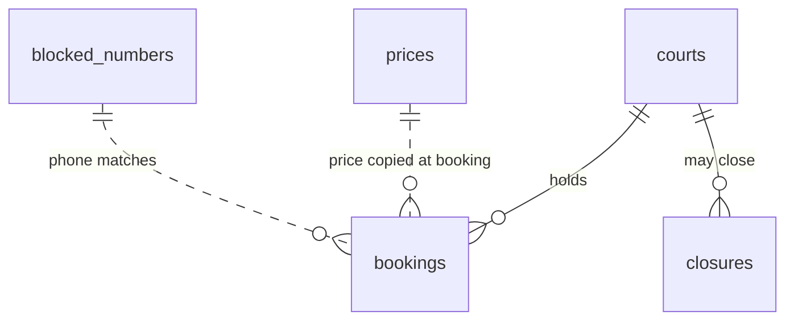

# Data model

## Storage decision

- **Chosen:** Supabase Free, Postgres, project region ap-southeast-1 (Singapore) (D-047, D-049). Players and the admin write at the same time, the one-winner rule must live in the database, and row-level security keeps personal fields admin-only.
- **Evidence:** S3.q1 inventory (D-020); S4 read and write paths (F-01 to F-05); free plan 500 MB database [cite: quota · https://supabase.com/pricing · n.d. · acc 2026-11-27 · primary · live]; no automatic backups on Free, covered by F-05 (D-013, D-052).
- **Rejected alternative:** Firestore. Its document model has no SQL exclusion or partial unique constraint for the slot rule (D-047).
- **Migration path:** standard Postgres dump and restore to any Postgres host, plus the weekly CSV (D-047). Moving to Supabase Pro keeps the same project (D-045).
- **Size:** about 1 KB per booking row, about 1 MB in a busy month, under 1% of 500 MB (RESEARCH.md, cost table).

## Entities

All tables live in schema `public`, have row-level security on, and use `timestamptz` in UTC. WIB conversion happens in code (D-027).

### courts

| Field | Type | Constraints | Notes |
|---|---|---|---|
| id | smallint | primary key | 1, 2, 3 |
| name | text | not null, unique | "Lapangan 1", "Lapangan 2", "Lapangan 3" (seeded) |

### prices

| Field | Type | Constraints | Notes |
|---|---|---|---|
| kind | text | primary key, check in ('regular','peak') | two rows (D-036) |
| amount | integer | not null, check between 1 and 5000000 | whole rupiah, final price incl. 10% PBJT (D-021, D-039) |
| updated_at | timestamptz | not null default now() | shown as "Terakhir diubah" |

### holidays

| Field | Type | Constraints | Notes |
|---|---|---|---|
| day | date | primary key | WIB date charged at the peak price all day (D-039) |
| created_at | timestamptz | not null default now() | |

### closures

| Field | Type | Constraints | Notes |
|---|---|---|---|
| id | bigint | primary key, identity | |
| court_id | smallint | null = all courts; references courts(id) | |
| starts_at | timestamptz | not null, minute = 0 | first closed hour |
| ends_at | timestamptz | not null, check ends_at > starts_at | end of the last closed hour |
| reason | text | not null, length 1–80 | shown as "Venue tutup – {reason}" (D-031) |
| created_at | timestamptz | not null default now() | |

### bookings

| Field | Type | Constraints | Notes |
|---|---|---|---|
| id | bigint | primary key, identity | |
| court_id | smallint | not null, references courts(id) | |
| slot_start | timestamptz | not null, minute = 0, second = 0 | hour start in UTC; WIB 08.00–23.00 |
| status | text | not null default 'active', check in ('active','cancelled') | |
| source | text | not null, check in ('online','manual') | "Online" or "Manual" tag (F-02) |
| name | text | null after erasure; 1–60 chars | booker or team name (D-020) |
| phone | text | null after erasure or for manual bookings; format `+62` + 8–11 digits | normalised from 08… or +62…, 10–13 digits |
| phone_last4 | text | null after erasure | for the F-03 lookup |
| code | text | not null, unique | 8 random characters from `23456789ABCDEFGHJKMNPQRSTUVWXYZ` (D-024) |
| price | integer | not null | copied from `prices` at booking time (D-036) |
| note | text | null, max 200 chars | manual bookings only |
| attendance | text | null, check in ('came','no_show') | set from slot start until end of next WIB day (D-032) |
| consent_at | timestamptz | not null for source = 'online' | D-056 |
| consent_version | text | not null for source = 'online' | `v1` (D-056) |
| request_key | uuid | not null, unique | one-time key per form (D-027) |
| created_at | timestamptz | not null default now() | |
| cancelled_at | timestamptz | null | |
| cancelled_by | text | null, check in ('player','admin') | |
| erased_at | timestamptz | null | set by the 90-day cleanup (D-025) |

### blocked_numbers

| Field | Type | Constraints | Notes |
|---|---|---|---|
| phone | text | primary key | normalised `+62…` |
| reason | text | not null, check in ('no_show','admin') | auto-block on the 2nd no-show, or by hand (D-030, D-032) |
| created_at | timestamptz | not null default now() | the daily job deletes rows older than 180 days unless renewed (D-064) |

### attempts

| Field | Type | Constraints | Notes |
|---|---|---|---|
| id | bigint | primary key, identity | |
| kind | text | not null, check in ('book','lookup') | 5 per 10 minutes each (D-023, D-033) |
| key_hash | text | not null | HMAC-SHA-256 of the connection IP with a server secret; never the raw IP (D-061) |
| created_at | timestamptz | not null default now() | rows deleted after 24 hours by the daily job |

### export_runs

| Field | Type | Constraints | Notes |
|---|---|---|---|
| id | bigint | primary key, identity | |
| created_at | timestamptz | not null default now() | latest row = "Terakhir diunduh" (F-05) |

### job_runs

| Field | Type | Constraints | Notes |
|---|---|---|---|
| id | bigint | primary key, identity | |
| job | text | not null | `daily_cleanup` |
| ran_at | timestamptz | not null default now() | |
| status | text | not null, check in ('ok','failed') | admin warning bar when the last run failed or is older than 2 days |
| detail | text | null | counts only, never names or numbers |

### Entity relationship diagram



## Relations

- courts 1—N bookings: every booking is for one court; delete is restricted (courts are seeded and never deleted).
- courts 1—N closures: a closure names one court or, with `court_id` null, all courts; delete restricted.
- prices → bookings: no foreign key; the price is copied into `bookings.price`, so later price changes never alter a booking (D-036).
- blocked_numbers → bookings: matched by `phone` value, no foreign key, because erasure nulls `bookings.phone` while a block may stay.
- export_runs, job_runs, holidays, attempts: standalone.

## Indexes

- `bookings (court_id, slot_start) where status = 'active'` — **unique**; the one-winner rule (D-027, U-08, R-8). A second active booking for the same court and hour fails with SQLSTATE `23505`.
- `bookings (code)` — unique; confirmation page and F-03 lookup.
- `bookings (request_key)` — unique; a retried submit returns the first booking (D-027).
- `bookings (slot_start)` — schedule reads for one WIB day and the 90-day cleanup.
- `bookings (phone, slot_start) where status = 'active'` — count upcoming bookings per number (D-023).
- `closures (starts_at)` — closures overlapping one day.
- `attempts (kind, key_hash, created_at)` — count attempts in the last 10 minutes.
- `job_runs (job, ran_at desc)`, `export_runs (created_at desc)` — latest row.

| Query | Index |
|---|---|
| Schedule for one WIB day (all courts) | `bookings (slot_start)`, `closures (starts_at)` |
| Insert booking, refuse the loser | unique `bookings (court_id, slot_start) where status = 'active'` |
| Retry with the same key | unique `bookings (request_key)` |
| Upcoming bookings for a number | `bookings (phone, slot_start) where status = 'active'` |
| Find by code + last 4 digits | unique `bookings (code)`, then compare `phone_last4` |
| Rate-limit count | `attempts (kind, key_hash, created_at)` |
| 90-day erasure | `bookings (slot_start)` |
| Latest export, latest job run | `export_runs (created_at desc)`, `job_runs (job, ran_at desc)` |
| CSV export | full scan; acceptable at about 1,000 rows a month (D-015) |

## Validation rules

- `slot_start` is on the hour; its WIB hour is 08 to 23; its WIB date is from today to today + 14 (D-029); it is later than now (D-027).
- The slot does not overlap a closure for that court or for all courts (D-031).
- Online bookings: the number is not blocked and has fewer than 2 active bookings whose `slot_start` is in the future (D-023).
- `name`: trimmed, 1–60 characters. `phone`: input matches `^(\+62|62|0)8[0-9]{7,10}$` after removing spaces and dashes; stored as `+628…` (F-01).
- `price` comes from `prices` (peak if the WIB date is Saturday, Sunday or a holiday, or the WIB hour is 16 to 23; regular otherwise), never from the form (D-024, D-036).
- Online bookings need `consent_at` and `consent_version` (D-056).
- Player cancel: `slot_start - now() >= 3 hours` (D-033). Attendance marks: from `slot_start` until the end of the next WIB day (D-032).
- A closure cannot cover hours that hold active bookings (D-032). `prices.amount` from 1 to 5000000 (D-039); holiday `day` not in the past.
- Booking writes go through one Postgres function `book_slot(...)` that applies these rules in one transaction and relies on the unique index for the race.

## Sample JSON

```json
{
  "id": 1842,
  "court_id": 2,
  "slot_start": "2026-12-04T12:00:00Z",
  "status": "active",
  "source": "online",
  "name": "Tim Garuda",
  "phone": "+6281234567890",
  "phone_last4": "7890",
  "code": "K7M4Q2XP",
  "price": 250000,
  "note": null,
  "attendance": null,
  "consent_at": "2026-12-01T03:15:42Z",
  "consent_version": "v1",
  "request_key": "8f14e45f-ceea-4e7a-9b6f-5d1c2a7b9e01",
  "created_at": "2026-12-01T03:15:42Z",
  "cancelled_at": null,
  "cancelled_by": null,
  "erased_at": null
}
```

`slot_start` 12:00Z is 19.00 WIB on Friday 4 December 2026, a peak hour. The price is a sample value; the owner sets real prices in F-04.

## Migrations

**0001_init — up** (`supabase/migrations/0001_init.sql`):

```sql
create table courts (id smallint primary key, name text not null unique);
insert into courts values (1,'Lapangan 1'),(2,'Lapangan 2'),(3,'Lapangan 3');
create table prices (kind text primary key check (kind in ('regular','peak')),
  amount integer not null check (amount between 1 and 5000000),
  updated_at timestamptz not null default now());
-- seed values are placeholders; the owner sets real prices in F-04 (M3)
insert into prices (kind, amount) values ('regular', 150000), ('peak', 250000);
create table bookings ( /* fields as in the bookings table above */ );
create unique index bookings_one_winner on bookings (court_id, slot_start) where status = 'active';
create unique index bookings_code on bookings (code);
create unique index bookings_request_key on bookings (request_key);
-- remaining tables, indexes, the book_slot() function and row-level security policies
```

**0001_init — down:** `drop function if exists book_slot; drop table if exists job_runs, export_runs, attempts, blocked_numbers, bookings, closures, holidays, prices, courts cascade;` Run down only on an empty or disposable project.

Later migrations add one file each (`0002_…`). Rules:
- Before any migration on the live project, download the CSV (F-05) and keep it.
- Every migration has a down script. A change that drops a column or erases data cannot be rolled back; restore from the CSV instead and say so in the migration header.
- After a migration, run the verification below and `npm run race-test`.

## Verification

Run in the Supabase SQL editor on a disposable project with seed data:

1. `insert` two active bookings for court 1 at the same `slot_start` → the second fails with `duplicate key value violates unique constraint "bookings_one_winner"`.
2. Cancel the first (`status = 'cancelled'`), insert again → succeeds; `select count(*) from bookings where court_id = 1 and slot_start = '<start>' and status = 'active'` → `1`.
3. `select book_slot(...)` with a slot inside a closure → returns `closed`; with a past slot → `past`; for a blocked number → `blocked`; for a third upcoming booking from one number → `limit`.
4. As role `anon`: `select name, phone from bookings` → permission error or 0 rows.
5. Erasure: a booking whose WIB play date is 91 days ago has `name`, `phone` and `phone_last4` null after the job; one at 89 days keeps them.
