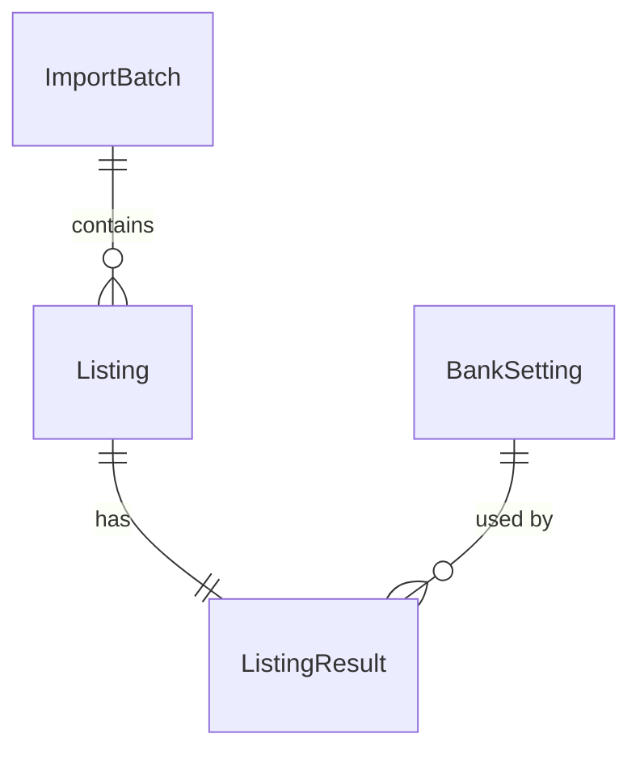

# Data model

Storage: one SQLite file `data/kpr.sqlite3` through Django 6.1.3 models (D-052, D-051). Money is stored as whole rupiah in integers; rates and percentages as basis points (1% = 100) so no float rounding enters a stored value. Dates are stored in UTC and shown in WIB, Asia/Jakarta (D-064). One user, so no owner column and no row-level access rules (D-005).

## Storage decision
- **Chosen:** SQLite, one file (D-052). Why: one device, offline (D-002, D-022); atomic saves for the F-05 rollback; a unique index on the listing link for D-039; filter and sort queries for D-036. Volume: about 1.200–7.200 listings in the first year (D-018).
- **Rejected:** JSON files (no atomic multi-record update); Postgres / Supabase (needs a server or account, breaks D-006, D-022 and the Rp0 budget).
- **Migration path:** Django migrations. A move to Postgres later keeps the same models, and would also reopen D-023 (sharing).

## Entities

### Profile
One row (singleton). Deleted alone by "Hapus profil keuangan saja" (D-026).

| Field | Type | Constraints | Notes |
|---|---|---|---|
| id | integer | PK, always 1 | singleton |
| net_income_monthly | integer | ≥ 0, nullable | rupiah; never logged (D-064) |
| other_installments_monthly | integer | ≥ 0, default 0 | rupiah |
| cash_available | integer | ≥ 0, nullable | rupiah; for the D-040 drop rule |
| current_age | integer | 18–80, nullable | typed by the owner, local only (D-055) |
| updated_at | datetime | not null | UTC; tab-conflict check (D-041) |

### BankSetting
One row per bank the owner uses (seed: BCA).

| Field | Type | Constraints | Notes |
|---|---|---|---|
| id | integer | PK | |
| name | text | unique, not null | e.g. "BCA" |
| min_dp_bp | integer | 0–10000, default 500 | 5% (D-010) |
| promo_rate_bp | integer | 0–3000, nullable | promo rate |
| promo_years | integer | 0–10, default 0 | promo length |
| floating_rate_bp | integer | 0–3000, default 1100 | 11% (D-035) |
| tenor_years | integer | 1–30, default 20 | |
| max_tenor_years | integer | 1–30, default 25 | D-055 |
| max_age_at_end | integer | 50–80, default 65 | D-055 |
| cap_bp | integer | 0–10000, default 3000 | 30% (D-035) |
| updated_at | datetime | not null | 30-day warning (D-020) |

### Criteria
One row (singleton).

| Field | Type | Constraints | Notes |
|---|---|---|---|
| id | integer | PK, always 1 | |
| max_price | integer | ≥ 0, nullable | must-have |
| areas | text | "jaksel", "depok" or both, comma-joined | must-have |
| min_bedrooms | integer | ≥ 0, default 0 | must-have |
| min_land_m2 | integer | ≥ 0, default 0 | must-have |
| condition | text | "new", "resale", "both" | must-have (D-015) |
| want_bigger_building | boolean | default false | nice-to-have |
| want_more_bedrooms | boolean | default false | nice-to-have |
| want_shm | boolean | default false | nice-to-have |
| want_new | boolean | default false | nice-to-have |
| updated_at | datetime | not null | |

### DefaultFigure
One row per editable cost figure (F-03).

| Field | Type | Constraints | Notes |
|---|---|---|---|
| id | integer | PK | |
| key | text | unique | e.g. `npoptkp.jaksel`, `bca.admin.tier2_bp`, `notary.estimate` |
| label_id | text | not null | Indonesian label |
| value | integer | ≥ 0, nullable | null = not filled (notary, insurance: D-056) |
| unit | text | "rupiah" or "bp" | |
| source_url | text | http/https only, nullable | shown as a link |
| checked_at | date | nullable | WIB date; 30-day clock (D-020) |

### ImportBatch
One row per imported file; deleted by "hapus per impor" with its listings (D-026).

| Field | Type | Constraints | Notes |
|---|---|---|---|
| id | integer | PK | |
| file_name | text | not null | shown in the list |
| imported_at | datetime | not null | UTC |
| rows_read | integer | ≥ 0 | |
| rows_rejected | integer | ≥ 0 | |

### Listing
One row per house; agent name and phone are never stored (D-024).

| Field | Type | Constraints | Notes |
|---|---|---|---|
| id | integer | PK | |
| batch_id | integer | FK ImportBatch, on delete cascade | newest import that touched it |
| link | text | unique, not null | same link = same house (D-039); http/https shown as link, else plain text (D-027) |
| title | text | not null, ≤ 300 chars | rendered as text (D-027) |
| price | integer | > 0 | rupiah (D-057 parsing) |
| land_m2 | integer | > 0 | |
| building_m2 | integer | > 0 | |
| bedrooms | integer | ≥ 0 | |
| area | text | "jaksel" or "depok" | |
| condition | text | "new" or "resale" | |
| certificate | text | nullable | e.g. SHM, HGB (D-033) |
| imported_at | datetime | not null | "cek apakah masih dijual" after 30 days |

### ListingResult
Calculated per listing at every recalculation; never edited by hand.

| Field | Type | Constraints | Notes |
|---|---|---|---|
| listing_id | integer | PK, FK Listing, on delete cascade | |
| bank_id | integer | FK BankSetting | bank used |
| tenor_used_years | integer | ≥ 1 | D-055 |
| installment_promo | integer | nullable | rupiah |
| installment_floating | integer | not null | rupiah |
| upfront_cash | integer | nullable | null = "belum lengkap" (D-056) |
| status | text | "pass", "fail", "incomplete" | |
| reasons | text | JSON list of reason keys | shown on the rejected list |
| nice_score | integer | 0–4 | ordering (D-036) |
| flags | text | JSON list: "scam_price", "cert_note", "stale" | D-032, D-033 |
| calculated_at | datetime | not null | |

### AppMeta
One row: `schema_version`, `backup_reminded_at`, `last_backup_at`, `luks_checked` (D-025, D-030).

## Relations
- ImportBatch 1—N Listing: a listing belongs to the latest import that touched it; deleting an import removes its listings (D-026).
- Listing 1—1 ListingResult: the cached calculation; deleted with the listing.
- BankSetting 1—N ListingResult: the bank used for that result.
- Profile, Criteria, AppMeta: singletons with no relations.



## Indexes
- Listing.link unique — the D-039 duplicate check on every import.
- ListingResult(status, nice_score DESC, upfront_cash ASC) — the shortlist order (D-036).
- Listing(area, price) — must-have filters and the area median per m² (D-032).
- DefaultFigure.key unique — lookup by key.

Query-to-index map: shortlist page → ListingResult composite index; import dedupe → Listing.link; median per m² per area → Listing(area, price), a scan of ≤ 7.200 rows is acceptable.

## Validation rules
- Import limits: ≤ 5 MB and ≤ 2.000 rows (D-027).
- Price formats: digits, "Rp1.500.000.000", "1,5 M", "850 jt"; else row rejected (D-057).
- Link must start with http:// or https:// to be rendered as a link (D-027).
- Percentages 0–100 (stored 0–10000 bp); amounts ≥ 0 (D-045).
- Age 18–80; age limit 50–80; tenor used = min(tenor, max tenor, age limit − age), at least 1 (D-055).
- Delete needs the exact word HAPUS; restore needs PULIHKAN (D-026, D-044).
- Backup files: JSON with `app`, `schema_version`, `exported_at`, `tables`; a newer `schema_version` is refused (D-046).

## Migrations
- **Up:** `.venv/bin/python manage.py migrate`. Before every migration that changes an existing table, the app writes an automatic backup (same format as Ekspor cadangan).
- **Down:** `.venv/bin/python manage.py migrate kpr <previous>`; when a down step would drop data, restore the automatic backup instead (F-05).
- **Verification:** the M4 restore drill (row counts equal before and after).

## Sample JSON
Price Rp1.500.000.000 with 5% DP gives a loan of Rp1.425.000.000; 2,70% promo for 1 year, then 11% for the remaining 19 years.
```json
{
  "link": "https://www.rumah123.com/properti/jakarta-selatan/contoh-123/",
  "title": "Rumah 2 lantai dekat MRT Lebak Bulus",
  "price": 1500000000,
  "land_m2": 90,
  "building_m2": 120,
  "bedrooms": 3,
  "area": "jaksel",
  "condition": "resale",
  "certificate": "SHM",
  "result": {
    "bank": "BCA",
    "tenor_used_years": 20,
    "loan": 1425000000,
    "installment_promo": 7690727,
    "installment_floating": 14355653,
    "upfront_cash": null,
    "status": "incomplete",
    "reasons": ["notary_missing", "insurance_missing"],
    "flags": []
  }
}
```
